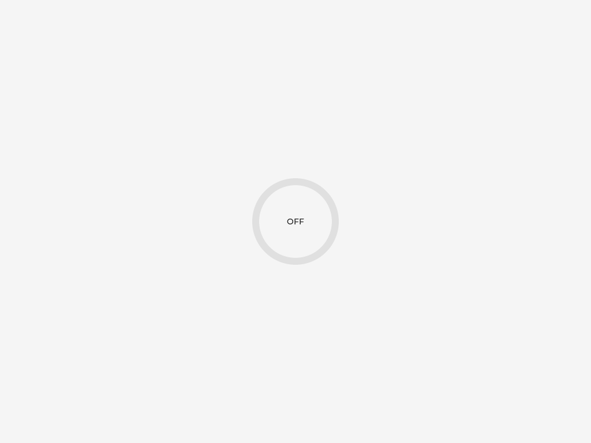
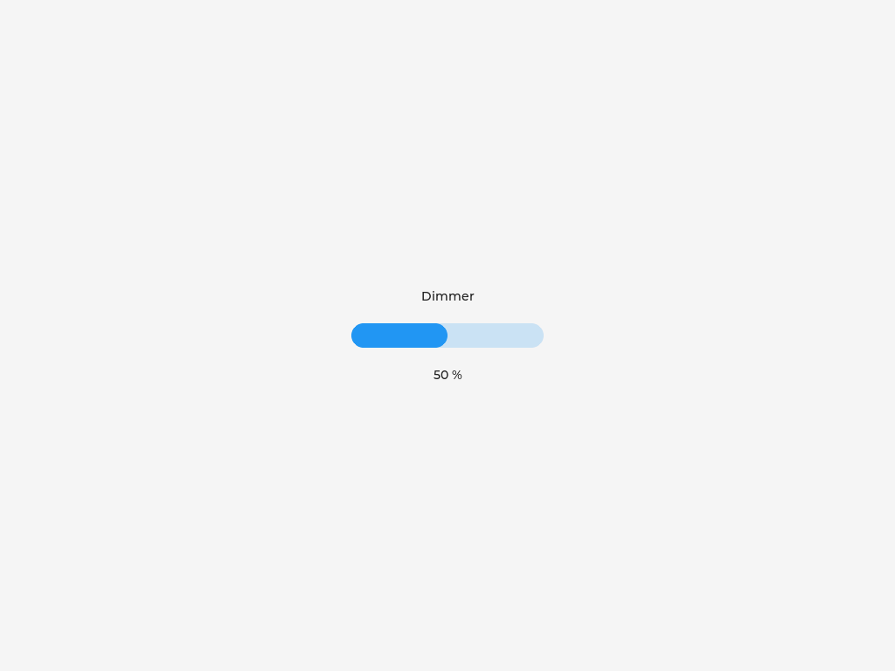
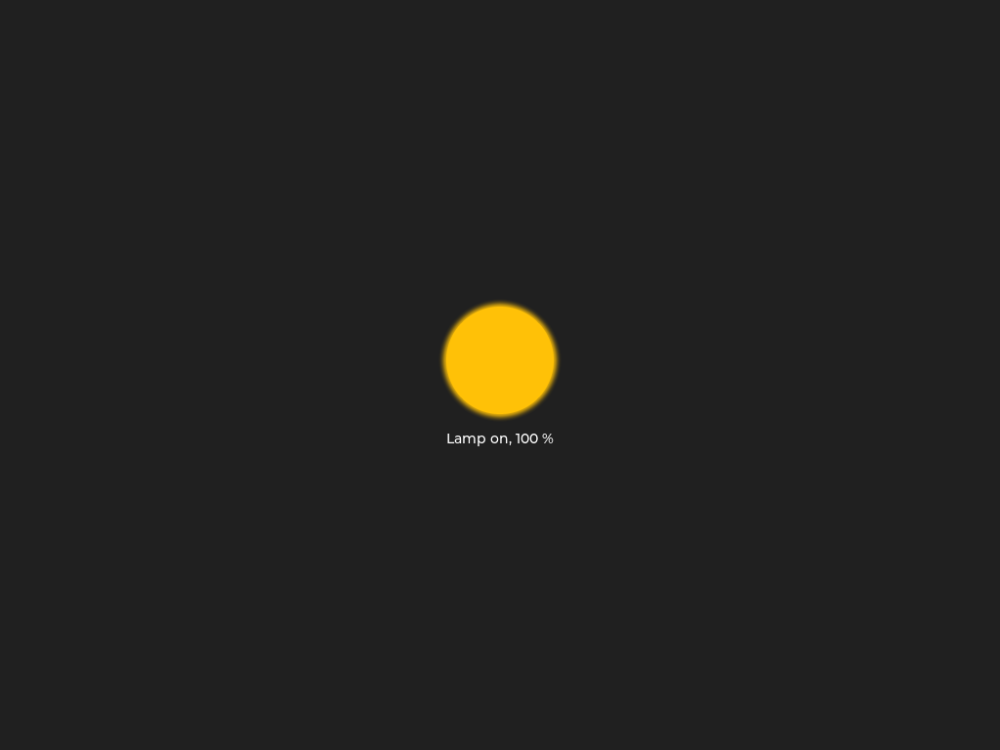

# Matter Light Bulb on Zephyr + QEMU

A commissionable Matter (project-chip/connectedhomeip) light bulb running on
Zephyr RTOS in QEMU (`qemu_x86`), commissioned over real Ethernet (no
BLE/Thread/Wi-Fi).

## Samples

Six independent, self-contained Zephyr applications, each buildable on its
own with no extra CLI flags:

- **[`0_plain/`](0_plain/)** — the base light bulb: on/off + level control,
  commissioning over Ethernet, persistent storage (survives QEMU restarts).
  Start here.
- **[`1_lvgl/`](1_lvgl/)** — `0_plain/` plus an LVGL widget (a yellow/grey arc +
  ON/OFF label) that reflects the bulb's on/off + level state in a QEMU
  window instead of only the console log.
- **[`2_llext/`](2_llext/)** — `0_plain/` plus a manufacturer-specific Matter
  cluster that can receive a Zephyr LLEXT (Linkable Loadable Extension)
  binary over Matter and load + run it at runtime. Includes sample
  extensions (`2_llext/extensions/`), a host-side script
  (`scripts/send-llext.py`) to send one, and a ztest suite for the cluster
  (`2_llext/tests/extension_value/`, run with `scripts/run-llext-ztest.sh`).
- **[`3_llext_lvgl/`](3_llext_lvgl/)** — `1_lvgl/` and `2_llext/` combined: the
  extension loaded over Matter *is* the bulb's LVGL UI. Includes two UI
  extensions (`3_llext_lvgl/extensions/ui_bar/`, `ui_led/`) and a ztest suite
  that screenshots them (`3_llext_lvgl/tests/extension_ui/`).
- **[`4_llext_dynamic/`](4_llext_dynamic/)** — a Matter bridge whose bridged
  devices arrive as extensions: a loaded extension adds its own endpoints,
  clusters, attributes and command handlers at runtime. Three sample
  extensions (`4_llext_dynamic/extensions/onoff_light/`, `temp_sensor/`,
  `counter/`) and a ztest suite (`4_llext_dynamic/tests/dynamic_endpoints/`).
- **[`5_nrf52840_thread/`](5_nrf52840_thread/)** — `4_llext_dynamic/` on real
  hardware: an nRF52840 DK with Matter over Thread and BLE commissioning, built
  with nRF Connect SDK v3.2.0 and optimized for flash space. Unlike the others
  it does not use the `connectedhomeip` worktree or `qemu_x86`; see
  [its section](#matter-over-thread-on-the-nrf52840-dk-5_nrf52840_thread).
- **[`6_nrf52840_signed/`](6_nrf52840_signed/)** — `5_nrf52840_thread/`, but the
  device only runs extensions signed for its firmware, with MCUboot's imgtool as
  the signing tool and the P-256 code Matter already needs for verifying. See
  [its section](#signed-extensions-6_nrf52840_signed).

Each QEMU sample carries its own `prj.conf`, `boards/qemu_x86.{conf,overlay}`,
`include/CHIPProjectConfig.h`, and `src/`. `boards/qemu_x86.overlay` is
Zephyr's auto-detected board-devicetree-overlay convention — it's picked up
automatically by `west build`, no `-DEXTRA_DTC_OVERLAY_FILE` needed.

## Prerequisites

- Zephyr workspace at `~/src/zephyrproject` (west installed, `qemu_x86`
  board support present).
- A `connectedhomeip` checkout of the
  [`zephyr-qemu-matter`](https://github.com/markushx/connectedhomeip/tree/zephyr-qemu-matter)
  branch at `~/src/connectedhomeip-worktree-zephyr`, bootstrapped -- see
  "Getting connectedhomeip" below.
- `zap-cli` on `PATH` for data-model codegen.
- QEMU with vmnet support (Homebrew's `qemu` formula has it).
- `chip-tool` built from the same CHIP checkout
  (`out/chip-tool/chip-tool`) for commissioning/control from the host.

### Getting connectedhomeip

Upstream `connectedhomeip` does not build and boot for `qemu_x86` as it is.
The samples need the
[`zephyr-qemu-matter`](https://github.com/markushx/connectedhomeip/tree/zephyr-qemu-matter)
branch of `markushx/connectedhomeip`, which is upstream `master` plus one
commit with four fixes:

- `config/zephyr/chip-module/CMakeLists.txt`: set GN's `target_cpu` for
  `qemu_x86`/`qemu_x86_64`, so the build doesn't fall back to the host CPU
  (arm64 on Apple Silicon) and pull in ARM-only flags.
- `src/platform/Zephyr/SysHeapMalloc.cpp`: initialize CHIP's heap before
  Zephyr's mbedTLS init hook, which allocates from it; otherwise the device
  can crash during boot.
- `build/chip/chip_codegen.cmake`: run codegen with the CHIP bootstrap
  environment's Python instead of the one Zephyr's CMake found.
- `scripts/setup/environment_no_cipd.json`: drop the `"rosetta": "never"`
  setting.

```
git clone --branch zephyr-qemu-matter https://github.com/markushx/connectedhomeip.git \
  ~/src/connectedhomeip-worktree-zephyr
cd ~/src/connectedhomeip-worktree-zephyr
python3 scripts/checkout_submodules.py --shallow --platform zephyr
source scripts/bootstrap.sh
scripts/examples/gn_build_example.sh examples/chip-tool out/chip-tool
```

(Add `--platform darwin` or `linux` to the `checkout_submodules.py` call,
matching your host, if the chip-tool build then misses a submodule.) In an
existing `connectedhomeip` clone, a second worktree works just as well:
`git remote add markushx https://github.com/markushx/connectedhomeip.git &&
git fetch markushx zephyr-qemu-matter && git worktree add
~/src/connectedhomeip-worktree-zephyr markushx/zephyr-qemu-matter`.

Each sample's `CMakeLists.txt` defaults `CHIP_ROOT` to
`~/src/connectedhomeip-worktree-zephyr`; override with `-DCHIP_ROOT=...` (or
the `CHIP_ROOT` environment variable) if yours lives elsewhere.

`bootstrap.sh` is only needed once; later shells just source
`.environment/activate.sh` (see "Build"). The bootstrap does not put
`zap-cli` on `PATH`: install the ZAP release named in the checkout's
`scripts/setup/zap.version` (`v2026.08.24` for this branch) from
<https://github.com/project-chip/zap/releases> and add its directory to
`PATH`. The commands in this README assume it is in
`~/src/connectedhomeip-worktree-zephyr/.environment/extra-cipd/zap`.

## Build

```
source ~/src/connectedhomeip-worktree-zephyr/.environment/activate.sh
export PATH="~/src/connectedhomeip-worktree-zephyr/.environment/extra-cipd/zap:$PATH"

~/src/zephyrproject/zephyr/.venv/bin/west build -b qemu_x86 \
  ~/src/matter-zephyr-qemu/0_plain -d ~/src/matter-zephyr-qemu/build-plain
```

Swap `0_plain` for `1_lvgl`, `2_llext`, `3_llext_lvgl` or `4_llext_dynamic` (and
`build-plain` for `build-lvgl` / `build-llext` / `build-llext-lvgl` /
`build-llext-dynamic` — build directories are
named without the number prefix) to build one of the other
samples — each needs its own build
directory since their Kconfig differs, but the command is otherwise
identical; no extra `-DEXTRA_CONF_FILE`/`-DEXTRA_DTC_OVERLAY_FILE` flags
required.

(`activate.sh` prints a harmless `ERR could not find arm-none-eabi-gcc`
check failure — this project doesn't need that toolchain; ignore it. Use
`west`'s absolute path, not a bare `west` on `PATH`: CHIP's own bootstrap
venv also ships a `west` package on an older Python, and if it shadows
Zephyr's own `west` the build fails with a `pathlib` crash. `west build`
must also be run from within the `~/src/zephyrproject` workspace — cd there
first, or pass the sample directory as an absolute path from wherever you
run it.)

## Run

```
scripts/run-qemu-macos.sh [build-plain|build-lvgl|build-llext|build-llext-lvgl|build-llext-dynamic]
```

Defaults to `build-plain`. Requires `sudo` (vmnet needs root) — run it
yourself in an interactive terminal so you can enter your password; it
can't be driven non-interactively. On first run it creates a 16 MiB disk
image at `<BUILD_DIR>/persistent.img` and Zephyr formats it FAT on first
boot. `run-qemu-macos.sh` auto-detects `CONFIG_DISPLAY=y` in the build
directory's `.config` (i.e. the `1_lvgl/` and `3_llext_lvgl/` samples) and opens a QEMU window
(`-device ramfb -vga none -display cocoa`) instead of running headless;
serial/monitor still work as normal over the terminal.

Optional args: `scripts/run-qemu-macos.sh [BUILD_DIR] [DISK_IMAGE]`.

### Commissioning

With the QEMU console running, from another terminal on the host:

```
dns-sd -B _matterc._udp                              # confirm the device is discoverable
out/chip-tool/chip-tool pairing onnetwork 1 20202021  # PASE + CASE
out/chip-tool/chip-tool onoff toggle 1 1
out/chip-tool/chip-tool levelcontrol move-to-level 128 0 0 0 1 1
```

(paths relative to the `connectedhomeip` checkout's `chip-tool` build output)

## Persistent storage

CHIP's Settings (fabric table, ACLs, session resumption, etc.) are stored in
a file on a FAT volume on a virtio-blk disk backed by
`<BUILD_DIR>/persistent.img`, instead of Zephyr's default `flash_simulator`
(which is RAM-backed and loses everything on every QEMU restart). This means
a device commissioned in one run is still commissioned after killing and
restarting QEMU, as long as the same disk image is reused — no
`isa-debug-exit`/normal QEMU shutdown, kill, or crash touches the image file
on disk. All samples build with this enabled.

**To reset persistence** (force re-commissioning, e.g. after changing the
data model or to start clean): delete the disk image and let the script
recreate it on the next run.

```
rm build-plain/persistent.img
scripts/run-qemu-macos.sh
```

## LVGL bulb UI (`1_lvgl/`)

An LVGL widget (a yellow/grey arc + ON/OFF label, `1_lvgl/src/gui/BulbUi.cpp`)
reflects the Matter on/off + level state in a QEMU window, instead of only
the console log.

| off | on, 100 % |
| --- | --- |
|  |  |

(QEMU screendumps taken by the `3_llext_lvgl/` test suite, whose built-in
UI is a copy of this widget; `1_lvgl/` has no automated screenshots of its
own.)

`1_lvgl/boards/qemu_x86.overlay` shrinks the declared `dram0`/`zephyr,sram`
size to exclude the top 4 MiB the board reserves for the ramfb framebuffer
-- without it, the linker is free to place ordinary kernel/network data in
the same physical bytes the framebuffer driver claims exclusively, which
doesn't itself break networking but is a real memory-safety bug in the
board's own devicetree. The actual networking breakage this port hit was
separate: `-vga none` (needed whenever `CONFIG_DISPLAY=y`, since ramfb
replaces the default VGA adapter) removes the PCI device normally at slot
1, which shifts `e1000`'s auto-assigned slot and, with it, its real
interrupt line -- silently breaking all incoming UDP delivery (confirmed
via GDB: the e1000 ISR simply never fired). `run-qemu-macos.sh` pins both
`e1000` and `virtio-blk-pci` to explicit PCI slots to make this stable
regardless of what else is on the command line -- see its comments for the
full story.

## LLEXT loadable extensions (`2_llext/`)

A manufacturer-specific Matter cluster (`0xFFF1FC01`, EP1,
`2_llext/src/llext/ExtensionLoaderCluster.cpp`) receives a Zephyr LLEXT binary
over Matter in chunks, verifies it, and loads + runs it at runtime -- see
`plan/plan-detailed.md`'s Milestone 3 section for the full design and the
real bugs found getting it working (a QEMU CPU-model/CLFLUSH mismatch was
the big one).

### Building the sample extensions

`2_llext/extensions/hello/` is a trivial standalone extension (prints a
message, proving the load-then-call round trip). `value42/` and
`value1337/` additionally export `int32_t get_value(void)`, which backs the
cluster's `ExtensionValue` attribute (see below). All are built with
Zephyr's LLEXT EDK, not as part of the main app build:

```
cd build-llext
cmake --build . --target llext-edk   # produces zephyr/llext-edk.tar.xz
mkdir -p /tmp/edk && tar -xf zephyr/llext-edk.tar.xz -C /tmp/edk
cd ../2_llext/extensions/hello
export ZEPHYR_SDK_INSTALL_DIR=~/zephyr-sdk-1.0.1
export PATH="$ZEPHYR_SDK_INSTALL_DIR/gnu/x86_64-zephyr-elf/bin:$PATH"
cmake -B build -DLLEXT_EDK_INSTALL_DIR=/tmp/edk/llext-edk
cmake --build build   # produces build/hello.llext
```

Repeat the last three lines in `../value42` and `../value1337` for the other
two.

(`cmake --build build-llext --target llext-edk` needs the same CHIP
bootstrap environment sourced as a normal build -- see "Build" above --
plus, if invoked standalone rather than via `west build`, `PATH` needs
`~/src/zephyrproject/zephyr/.venv/bin` first so its own internal Python
lookup finds the venv, not a bare system `python3`.)

### Sending the extension

```
scripts/send-llext.py 2_llext/extensions/hello/build/hello.llext <node-id>
```

Drives chip-tool's generic `any command-by-id` invocation (no ZAP/codegen
entry needed for a manufacturer cluster) to send `LoadStart`/`LoadChunk`×N/
`LoadDone`. Watch the device's own console (or `<BUILD_DIR>/console.log`) for
`hello from llext` -- confirms the extension was loaded *and executed*, not
just linked. Read back progress with:

```
out/chip-tool/chip-tool any read-by-id 0xFFF1FC01 0 <node-id> 1   # Status: 0=Idle 1=Receiving 2=Loaded 3=Error
```

Only one extension is loaded at a time: a successful `LoadDone` unloads the
previous one before loading the new one.

### Extension-provided attribute value

Attribute 1 (`ExtensionValue`, nullable int32) is provided by the loaded
extension rather than by the app: if the extension exports
`int32_t get_value(void)` (`LL_EXTENSION_SYMBOL(get_value)`), every read of
the attribute calls it and returns the result. It reads as null when nothing
is loaded or the extension has no `get_value` (e.g. `hello`).

```
scripts/send-llext.py 2_llext/extensions/value42/build/value42.llext <node-id>
out/chip-tool/chip-tool any read-by-id 0xFFF1FC01 1 <node-id> 1   # Data = 42 (signed)
```

### Tests

```
scripts/run-llext-ztest.sh
```

builds `2_llext/tests/extension_value/` into `build-llext-test/` and runs it
under QEMU -- **no sudo, no commissioning, no chip-tool needed**. It is a
Zephyr ztest suite that links the real `ExtensionLoaderCluster` with the
`2_llext/` sample's own Kconfig/devicetree, embeds `hello`, `value42` and
`value1337` (built in-tree from the same sources via `add_llext_target`),
and drives the cluster's actual `LoadStart`/`LoadChunk`/`LoadDone` and
`ReadAttribute` handlers with TLV-encoded requests -- everything except the
Matter transport. It checks that:

- `ExtensionValue` is null with nothing loaded;
- loading `value42` → `value1337` → `value42` reads back 42 → 1337 → 42;
- an extension without `get_value` (`hello`) reads back null;
- a transfer with a bad CRC fails, leaves the previous extension (and its
  value) in place, and a correct retry then works.

The script exits 0 only on ztest's `PROJECT EXECUTION SUCCESSFUL`; the full
console output is in `build-llext-test/console.log`.

`scripts/test-llext-values.py <node-id>` is the over-the-air counterpart: run
against a running, commissioned `build-llext` device (so it needs
`run-qemu-macos.sh` and its sudo), it sends `value42`, `value1337` and
`value42` again through chip-tool and checks that `ExtensionValue` reads back
42 / 1337 / 42.

## Extension-provided LVGL UI (`3_llext_lvgl/`)

Combines the two samples above: the device shows the `1_lvgl/` sample's bulb
widget until an extension that provides a UI is loaded through the
`ExtensionLoaderCluster`, which then replaces it -- no rebuild or restart of
the device. Loading another extension swaps the UI again; the new UI picks
up the bulb's current on/off + level state.

| built-in | `ui_bar` | `ui_led` |
| --- | --- | --- |
|  |  |  |

(Screenshots taken by the test suite below.)

### Writing a UI extension

The contract is `3_llext_lvgl/include/bulb_ui_extension.h`: export two
functions with `LL_EXTENSION_SYMBOL`,

```c
void ui_create(lv_obj_t *parent);          /* build the UI inside parent */
void ui_update(bool on, uint8_t percent);  /* show the bulb's state */
```

Both are called on the app's GUI thread only. `parent` is a screen-sized
container owned by that UI; the app deletes it, and everything in it, before
the extension is unloaded, so there is no destroy hook.

An extension can only call the LVGL functions the app exports to it, listed
in `3_llext_lvgl/src/gui/LvglExports.c` (objects, local styles, colors, and
the label/arc/bar/led widgets). Calling anything else makes the load fail
with `Undefined symbol ...` on the device console and `TransferStatus` =
Error; add an `EXPORT_SYMBOL` line there and rebuild the app. (`static
inline` LVGL helpers such as `lv_pct()` need no entry.)

### Building and sending the UI extensions

Same procedure as for `2_llext/` ("Building the sample extensions" above),
against this sample's own EDK:

```
cd build-llext-lvgl
cmake --build . --target llext-edk
mkdir -p /tmp/edk-lvgl && tar -xf zephyr/llext-edk.tar.xz -C /tmp/edk-lvgl
export ZEPHYR_SDK_INSTALL_DIR=~/zephyr-sdk-1.0.1
export PATH="$ZEPHYR_SDK_INSTALL_DIR/gnu/x86_64-zephyr-elf/bin:$PATH"
for ext in ui_bar ui_led; do
  cmake -S ../3_llext_lvgl/extensions/$ext -B ../3_llext_lvgl/extensions/$ext/build \
    -DLLEXT_EDK_INSTALL_DIR=/tmp/edk-lvgl/llext-edk
  cmake --build ../3_llext_lvgl/extensions/$ext/build   # produces build/$ext.llext
done
```

With `scripts/run-qemu-macos.sh build-llext-lvgl` running and the device
commissioned:

```
scripts/send-llext.py 3_llext_lvgl/extensions/ui_bar/build/ui_bar.llext <node-id>
out/chip-tool/chip-tool onoff on <node-id> 1
out/chip-tool/chip-tool levelcontrol move-to-level 128 0 0 0 <node-id> 1
scripts/send-llext.py 3_llext_lvgl/extensions/ui_led/build/ui_led.llext <node-id>
```

The QEMU window switches from the arc to the dimmer bar, follows the on/off
and level commands, then switches to the lamp. An extension without
`ui_create`/`ui_update` (e.g. `2_llext/`'s `hello`) still loads; the UI then
falls back to the built-in one.

### Tests

```
scripts/run-llext-ztest.sh 3_llext_lvgl/tests/extension_ui
```

Like the `2_llext/` suite, this needs no sudo, commissioning or chip-tool, and
opens no window. It runs the real cluster, GUI thread and LVGL rendering in
QEMU, loads `ui_bar` → `ui_led` → `ui_bar` through the cluster's command
handlers while changing the bulb state, and finally drops the cluster to
check the built-in UI comes back. After each step the script saves a QEMU
screendump to `build-llext-lvgl-test/screenshots/<step>.png`. Besides
ztest's own verdict, the run fails if a screenshot is missing or if any two
are identical -- every step is supposed to change the picture. Look at the
PNGs to judge the UIs themselves.

## Extension-provided Matter endpoints (`4_llext_dynamic/`)

A Matter bridge, modelled on connectedhomeip's
[`examples/bridge-app/linux`](https://github.com/project-chip/connectedhomeip/tree/master/examples/bridge-app/linux)
and nRF Connect's
[bridge sample](https://github.com/nrfconnect/ncs-matter/tree/main/samples/bridge)
-- except that the bridged devices are not compiled into the app. Each one
is an LLEXT extension, sent to the running device through the
`ExtensionLoaderCluster`, that describes its endpoint and implements its
behaviour:

| What the extension provides | How |
|---|---|
| Endpoints | `matter_dyn_endpoint_add()` with a device type and a name; shows up as a bridged node below the Aggregator (endpoint 1) |
| Clusters | a table per endpoint: standard ones, or manufacturer-specific ones the app has never heard of |
| Attributes | a table per cluster (ID, type, writable/nullable) plus `read`/`write` callbacks |
| Command servers | a list of accepted command IDs plus an `invoke` callback that gets the decoded command fields |

The contract is `4_llext_dynamic/include/matter_dynamic_extension.h`. On the
app side, `src/dynamic/DynamicEndpointManager.cpp` turns those tables into
Ember dynamic endpoints at runtime -- what `bridge-app` declares at compile
time with its `DECLARE_DYNAMIC_*` macros -- with external attribute storage
routed to the extension, and adds the Descriptor and Bridged Device Basic
Information clusters every bridged node needs. The data model is
`bridge-app`'s (`bridge-app.zap`): root node on endpoint 0, Aggregator on
endpoint 1; there is no light bulb in this sample.

Unlike in the two previous samples, up to four extensions can be loaded side
by side. A successful load goes into the lowest free slot; the cluster's new
`Unload` command (ID 3, field 0 = slot) removes an extension again, together
with every endpoint it added. Attribute 2, `LoadedExtensions`, is a bitmap of
the slots in use. Up to 8 dynamic endpoints exist in total
(`CHIP_DEVICE_CONFIG_DYNAMIC_ENDPOINT_COUNT`).

The three sample extensions:

- `onoff_light` -- an On/Off Light (device type 0x0100). It only stores the
  `OnOff` attribute; the On/Off/Toggle commands are handled by the SDK's own
  On/Off cluster server, which writes the attribute.
- `temp_sensor` -- a Temperature Sensor (0x0302) with a simulated reading:
  its `poll()` function, called by the app about once per second, moves the
  temperature between 20 and 25 °C and reports the change.
- `counter` -- a manufacturer-specific cluster `0xFFF1FC02` with a read-only
  `Count`, a writable `Step` (1..100, enforced by the extension) and two
  commands, `Increment` (optional field 0: amount) and `Reset`, all
  implemented in the extension.

All calls into an extension happen on the Matter thread, and unloading
removes its endpoints first, so an extension needs neither locking nor a
cleanup hook.

### Building and sending the extensions

Build the app like the other samples (`4_llext_dynamic` →
`build-llext-dynamic`), then the extensions against its EDK:

```
cd build-llext-dynamic
cmake --build . --target llext-edk
mkdir -p /tmp/edk-dynamic && tar -xf zephyr/llext-edk.tar.xz -C /tmp/edk-dynamic
export ZEPHYR_SDK_INSTALL_DIR=~/zephyr-sdk-1.0.1
export PATH="$ZEPHYR_SDK_INSTALL_DIR/gnu/x86_64-zephyr-elf/bin:$PATH"
for ext in onoff_light temp_sensor counter; do
  cmake -S ../4_llext_dynamic/extensions/$ext -B ../4_llext_dynamic/extensions/$ext/build \
    -DLLEXT_EDK_INSTALL_DIR=/tmp/edk-dynamic/llext-edk
  cmake --build ../4_llext_dynamic/extensions/$ext/build   # produces build/$ext.llext
done
```

With `scripts/run-qemu-macos.sh build-llext-dynamic` running and the device
commissioned (it is a different device than the other samples -- commission
it afresh, its `persistent.img` starts empty):

```
# Endpoint 3 appears: an on/off light
scripts/send-llext.py 4_llext_dynamic/extensions/onoff_light/build/onoff_light.llext <node-id>
out/chip-tool/chip-tool descriptor read parts-list <node-id> 1
out/chip-tool/chip-tool onoff toggle <node-id> 3
out/chip-tool/chip-tool onoff read on-off <node-id> 3

# Endpoint 4: a temperature sensor whose value moves by itself
scripts/send-llext.py 4_llext_dynamic/extensions/temp_sensor/build/temp_sensor.llext <node-id>
out/chip-tool/chip-tool temperaturemeasurement read measured-value <node-id> 4

# Endpoint 5: the custom Counter cluster -- Increment, Increment by 10, read Count
scripts/send-llext.py 4_llext_dynamic/extensions/counter/build/counter.llext <node-id>
out/chip-tool/chip-tool any command-by-id 0xFFF1FC02 0 '{}' <node-id> 5
out/chip-tool/chip-tool any command-by-id 0xFFF1FC02 0 '{"0": 10}' <node-id> 5
out/chip-tool/chip-tool any read-by-id 0xFFF1FC02 0 <node-id> 5

# Unload slot 1 (the temperature sensor): endpoint 4 disappears
out/chip-tool/chip-tool any command-by-id 0xFFF1FC01 3 '{"0": 1}' <node-id> 1
out/chip-tool/chip-tool descriptor read parts-list <node-id> 1
```

Endpoint IDs are handed out in order starting at 3 (0-2 belong to the data
model) and are not reused while the device is running, so the numbers above
only hold for a fresh boot. Loaded extensions are not persisted: after a
restart the bridge is empty again.

### Tests

```
scripts/run-llext-ztest.sh 4_llext_dynamic/tests/dynamic_endpoints
```

Unlike the two suites above, this one boots the sample's whole Matter server
inside QEMU (still no sudo, commissioning or chip-tool), loads the three
extensions through the loader cluster and then acts as the controller: it
reads, writes and invokes on the new endpoints through the data model
provider, the layer directly below the Interaction Model engine. It checks
each extension's behaviour, several extensions side by side, and that
unloading one removes exactly its endpoint.

## Matter over Thread on the nRF52840 DK (`5_nrf52840_thread/`)

The same extension loader and dynamic endpoints as `4_llext_dynamic/`, on an
nRF52840 DK. Differences from the QEMU sample:

- **SDK:** nRF Connect SDK v3.2.0 and its Matter fork, with Nordic's `Nrf::Matter`
  init and Thread driver, and Nordic's `matter_bridge` data model.
- **Flash:** no MCUboot, OTA or factory data, no shell, no logging, LTO on. It uses
  593 KB of 976 KB flash and 195 KB of 256 KB RAM. There are **no firmware updates
  over the air**; flash with J-Link. `logging.conf` adds a UART console (661 KB).
- **Credentials:** the SDK's test DAC and the default test pairing code
  (20202021 / 3840, manual code `34970112332`). A matterjs-server only accepts this
  with `--enable-test-net-dcl`.
- **Limits:** two extensions at a time, 8 KiB each, four dynamic endpoints.
- **Extensions survive a reboot,** with the same endpoint IDs and `UniqueID`s. Their
  state in RAM doesn't, so a light comes back in its default state. See
  [below](#extensions-across-reboots).
- **Memory protection:** `CONFIG_ARM_MPU=n`, because extensions run from RAM. That
  also means no stack guards.

### Building

```sh
T=/opt/nordic/ncs/toolchains/322ac893fe    # the toolchain of NCS v3.2.0
export PATH="$T/bin:$T/opt/bin:$T/nrfutil/bin:$T/opt/zephyr-sdk/arm-zephyr-eabi/bin:$PATH"
export ZEPHYR_TOOLCHAIN_VARIANT=zephyr ZEPHYR_SDK_INSTALL_DIR=$T/opt/zephyr-sdk
export ZEPHYR_BASE=/opt/nordic/ncs/v3.2.0/zephyr
R=$PWD

# Add -- -D5_nrf52840_thread_EXTRA_CONF_FILE=$R/5_nrf52840_thread/logging.conf for logs.
west build -b nrf52840dk/nrf52840 --sysbuild -d build-nrf-thread 5_nrf52840_thread
nrfjprog --family NRF52 --program build-nrf-thread/merged.hex --chiperase --verify --reset

# Extensions (cmake >= 3.28, so not the NCS toolchain's own).
ninja -C build-nrf-thread/5_nrf52840_thread llext-edk
mkdir -p /tmp/edk-nrf && tar -xf build-nrf-thread/5_nrf52840_thread/zephyr/llext-edk.tar.xz -C /tmp/edk-nrf
cd 5_nrf52840_thread/extensions/counter
/opt/homebrew/bin/cmake -B build -DLLEXT_EDK_INSTALL_DIR=/tmp/edk-nrf/llext-edk
/opt/homebrew/bin/cmake --build build
```

### Commissioning

Connect to the DK's UART (first of its two serial ports, 115200 baud) to see the
log of a `logging.conf` build. The device advertises over BLE after a reset, with
manual pairing code `34970112332` or QR code `MT:6FCJ142C00KA0648G00`. Commission
it from a phone, for example with the Home Assistant Companion app, or from any
controller with Bluetooth and the Thread network's credentials. Home Assistant's
Matter server must have `--enable-test-net-dcl` set, or it rejects the test DAC.

Button 1 on the DK is handled by Nordic's common board code, but this sample's
factory reset hasn't been tried. To start over, erase the whole chip by flashing
with `--chiperase`. To update the firmware and keep the commissioning, flash with
`--sectorerase` instead; the image doesn't cover the settings partition.

### Sending an extension through a matterjs-server

matterjs-server rejects commands on a cluster it has no definition for
(`Cluster Id "4294048769" unknown`), and definitions are compiled in. To leave the
server unchanged, make `chip-tool` a second admin. The server then picks up the new
endpoints on its own and can control them, because they use standard clusters:

```sh
scripts/matterjs-share-node.mjs ws://<server>:5580/ws <server-node-id> <chip-tool-node-id>
scripts/send-llext.py 5_nrf52840_thread/extensions/counter/build/counter.llext <chip-tool-node-id>
```

For a server you run yourself, `5_nrf52840_thread/matterjs/extension-loader.ts` is
the cluster definition for its `custom-clusters` package, after which
`device_command` works with `loadStart`, `loadChunk`, `loadDone` and `unload`. This
file hasn't been compiled or run yet. Reads of the cluster work on any server, here
`LoadedExtensions` and `TransferStatus`:

```json
{"command": "read_attribute", "args": {"node_id": 9, "attribute_path": "1/4294048769/2"}}
{"command": "read_attribute", "args": {"node_id": 9, "attribute_path": "1/4294048769/0"}}
```

Tested end to end against matterjs-server 1.4.0 (matter.js 0.17.9) on a live Thread
network: `onoff_light` sent with the commands above became endpoint 3, the server
listed it in the Aggregator's parts list without being told, and read and toggled it
with `device_command`. How the Home Assistant UI presents such an endpoint hasn't been
checked.

### Extensions across reboots

`LoadDone` stores the binary in the 16 KiB `extension_storage` flash partition, and
`RestoreExtensions()` loads it again about a second after boot. What makes a stored
binary valid is a small record in the settings, written after the extension has run.
So a power cut while storing leaves nothing half-valid, an extension that crashes
straight away isn't kept, and a factory reset, which clears the settings, invalidates
the binaries too (their bytes stay in flash until overwritten).

An extension runs with full privileges, and now stays across reboots, so:

- **The commands need Administer**, not Operate. There is still no signature check:
  the CRC only detects corruption. Don't use this beyond a demo without adding one.
- **An extension that keeps taking the device down gets disabled.** Each restore is
  counted first, and the count is cleared once the device has been up for 60 seconds.
  After 3 restores in a row without that, the boot skips the extension. The count is
  per device, not per extension, because it isn't known which one caused the reset:
  all stored extensions get disabled. So do 3 quick power cycles on a healthy device.
- **Hangs count too:** the watchdog (30 s, fed every 10 s) turns them into resets. It
  covers the main and Matter threads in general, not only extensions.
- **Another firmware disables stored extensions:** each record holds a CRC of the
  firmware image it was stored on, since a changed struct layout wouldn't be noticed at
  load time. Any firmware change means sending extensions again, built with the new EDK.

`DisabledExtensions` (attribute 3) is a bitmap of the slots this happened to. Sending
another extension replaces a disabled one, or `Unload` clears it. Reading it, and
`BootReason` (4 is a hardware watchdog reset, 6 a software reset):

```json
{"command": "read_attribute", "args": {"node_id": 9, "attribute_path": "1/4294048769/3"}}
{"command": "read_attribute", "args": {"node_id": 9, "attribute_path": "0/51/4"}}
```

Tested on the DK on the same network, on logging and release builds. The logging build
had `CONFIG_RESET_ON_FATAL_ERROR=y` added, because `logging.conf` halts on a fatal error
instead, so there a crashing extension needs a manual reset for each attempt.

| Test | Result |
| --- | --- |
| Reboot with `onoff_light` loaded | Same endpoint and `UniqueID`, server can toggle it |
| Load A and B, unload A, reboot | B keeps its endpoint; the next one sent gets a new ID |
| Crash in `run()` | Device resets once, extension is not kept |
| Crash in `poll()`, 5 s after boot | 3 restores, then disabled; `Unload` clears it |
| Hang in `poll()` | Watchdog resets, 3 restores, then disabled |
| 4 reboots, 75 s apart, healthy extension | Stays loaded |
| Reflash with another firmware | Disabled; sending an extension replaces it |
| Reflash with `--sectorerase` | Fabrics kept, settings partition byte-identical |

A factory reset hasn't been tried, as it would remove the DK from Home Assistant. That it
invalidates the stored binaries comes from reading the SDK's reset code.

### Porting notes

What differed from `4_llext_dynamic/`, in case this is moved to another board or SDK:

- **LLEXT and LTO don't link together**: `syscall_exports_llext.c` and
  `syscall_weakdefs_llext.c` declare every syscall implementation as a variable ("function
  redeclared as variable"). `CMakeLists.txt` excludes those two files from LTO.
- **The EDK passes `-flto` on to extensions**, which would then contain no machine code.
  Their `CMakeLists.txt` adds `-fno-lto` after the EDK's flags.
- **`zephyr/kernel.h` doesn't compile from an NCS EDK on nRF52**: it reaches a private
  802.15.4 driver header that the EDK doesn't export. Extensions include `sys/printk.h`
  and `sys/util.h` instead.
- **`CONFIG_CHIP_OTA_REQUESTOR=n` in `prj.conf` has no effect**: sysbuild overrides it.
  Set `SB_CONFIG_MATTER_OTA=n` in `sysbuild.conf`.
- **Bridged Device Basic Information is Ember-based in this SDK**, so
  `DynamicEndpointManager` declares its attributes on each endpoint and answers them from
  the external read callback, instead of registering a cluster class.
- **Settings storage must be set explicitly.** Without Nordic's static partition map it
  defaults to 8 KiB, of which NVS can use one 4 KiB sector. That was full with two fabrics,
  and adding a third failed at the last commissioning step with `PSA error -142`.
- **Resizing the settings partition loses the commissioning**, even though the data stays on
  flash: it grows downward, so the old sector is no longer first, and NVS starts over at the
  new first sector. To keep it, copy the old sector to the new start of the partition and
  erase the original (NVS offsets are relative to the sector). Going from 8 to 32 KiB this
  meant copying `0xFE000-0xFEFFF` to `0xF8000`, which brought both fabrics back.
- **Partitions are pinned in `pm_static.yml`,** so that a change to the extension storage
  can't move the settings.
- **`llext_load()` relocates the binary in its buffer**, so it has to be stored before
  loading. The buffer is then no longer the binary that was sent.
- **The restore has to be scheduled, not called from `mPostServerInitClbk`:** Nordic's init
  enables the watchdog after that callback, and a hang there would never reset.
- **The nRF52's watchdog keeps running across a soft reset.** A crash loop faster than the
  feed interval never feeds it, so 30 s after the last feed it fires, which shows as one
  more reboot, with `BootReason` 4, after the loop has ended. Harmless.
- **`nrfjprog` can trigger the watchdog:** a plain `--memrd` on a running device caused a
  watchdog reset (seen once, a `--memwr` right after didn't). Expect a reboot when attaching.
- **After a reboot, commands fail for a while** (`CHIP Error 0x000000DB`, or `Operation
  aborted` from the server) until sessions are re-established, which took up to two minutes.
- **`bridge.zap` is Nordic's, unmodified.** It still declares OTA Requestor and Wi-Fi
  diagnostics, and its placeholder endpoint has clusters no extension here uses. Trimming them
  needs a ZAP regeneration and would save more flash.

## Signed extensions (`6_nrf52840_signed/`)

`5_nrf52840_thread/`, except that the device refuses any extension that isn't signed
for its firmware. Before, anyone with Administer on any fabric could run code on it.
No new crypto is involved: extensions are signed with MCUboot's `imgtool` from NCS, and
checked with CHIP's `P256PublicKey`, which Matter links in anyway. The firmware grows
by about 1 KiB, and a signed extension by about 200 bytes.

**Status:** not tried on the DK yet. The firmware builds, and
`scripts/run-llext-ztest.sh 6_nrf52840_signed/tests/signature` runs the check itself
under QEMU with CHIP's PSA crypto, against images from `imgtool`. What only the DK can
show: `ExtensionLoaderCluster` running the ELF behind the header, the restore at boot,
how long verifying takes there, and that `ExtensionStore::FirmwareId()` gets the same
value as the script (`_flash_used` is the size of `zephyr.bin`, and `merged.hex` has the
same bytes, so it should).

### Signing

```sh
# With the PATH from "Building" above: imgtool needs the toolchain's Python packages.
# Once. Writes the private key to ~/.config/matter-zephyr-qemu/, and the public key to
# 6_nrf52840_signed/keys/, from where the firmware build embeds it.
scripts/sign-llext.py keygen

west build -b nrf52840dk/nrf52840 --sysbuild -d build-nrf-signed 6_nrf52840_signed
nrfjprog --family NRF52 --program build-nrf-signed/merged.hex --sectorerase --verify --reset

# Build the extension from this build's EDK as in "Building" above, then:
scripts/sign-llext.py sign 6_nrf52840_signed/extensions/counter/build/counter.llext \
    --firmware build-nrf-signed/6_nrf52840_signed/zephyr/zephyr.bin
scripts/send-llext.py 6_nrf52840_signed/extensions/counter/build/counter.signed.llext <chip-tool-node-id>
```

The repository has a public key whose private key is on the machine it was created on.
Anywhere else, run `keygen` first, which replaces the public key, and rebuild. There's
no way to add a second key to a device: a new key means flashing new firmware.

### What the device does

The image is `imgtool`'s format: a 32-byte header, the unchanged ELF, the firmware ID in
a signed TLV (`0xa0`, the same CRC of the firmware as in `5_nrf52840_thread/`), and the
signature over all of these.

- **`LoadDone` verifies first**, before writing to flash, touching a stored extension, or
  parsing any of the ELF. A refusal is a cluster-specific status on the command, as
  logging is usually off: 1 for no valid signature, 2 for signed for another firmware.
- **Every boot verifies again**, before the restore is counted. What fails ends up in
  `DisabledExtensions`, as before.
- **Sample 5's records are ignored:** they use another settings key, so a stored unsigned
  extension doesn't come back when switching to this firmware, and doesn't show up as
  disabled either. Sending an extension overwrites its bytes in flash.

### What this doesn't do

- **A signed extension still has full control:** no MPU, as in sample 5. A bug in one
  can read all memory, including Matter's keys. Signing says who wrote it, not that it's safe.
- **Physical access defeats it:** there's no secure boot, and `CONFIG_NRF_APPROTECT_LOCK`
  isn't set, so anyone with SWD can replace the firmware along with the key.
- **Revoking means reflashing:** there's no version check or security counter. An old
  signed extension can be sent again for as long as the firmware stays the same, and
  any firmware change invalidates all signatures. That also means signing extensions
  again after every firmware build that changes the image.
- **The private key is a plain file**, good enough for a demo. For real use it belongs
  in an HSM or signing service, which `imgtool` can work with through `--vector-to-sign`.

Upstream Zephyr has no signing yet. [RFC #119605](https://github.com/zephyrproject-rtos/zephyr/issues/119605)
proposes it, with `imgtool`'s format suggested in its comments but nothing decided, so
this format may not match what ends up in Zephyr.

## Debugging tools

`run-qemu-macos.sh` also supports:
- `GDB=1 scripts/run-qemu-macos.sh ...` -- exposes a GDB stub on `tcp::1234`
  (`-s`, boot proceeds normally). Attach with e.g.
  `~/zephyr-sdk-*/gnu/x86_64-zephyr-elf/bin/x86_64-zephyr-elf-gdb <build>/zephyr/zephyr.elf -ex "target remote :1234"`.
- A second, scriptable QEMU monitor at `<BUILD_DIR>/mon.sock` (HMP, in
  addition to the normal interactive one on the terminal via `Ctrl-A C`) --
  useful for e.g. `info pci` to check real PCI slot/IRQ assignments without
  needing to switch away from the serial console.
- Console output (serial + the interactive monitor) is duplicated to
  `<BUILD_DIR>/console.log` (truncated each run) for inspection without
  copy-pasting from the terminal.

## Logging

Each sample's `include/CHIPProjectConfig.h` mutes Progress/Detail-level
logging from CHIP's Exchange Manager (`EM`), Secure Channel (`SC`), and
interaction-model/data-management (`DMG`) log modules — these are extremely
chatty (every message send/receive, every attribute read) and were drowning
out everything else, including ZCL (`ZCL`) logging, in the 16 KB log ring
buffer. Error-level logging from all three is left intact; ZCL and all
other modules are unaffected.
