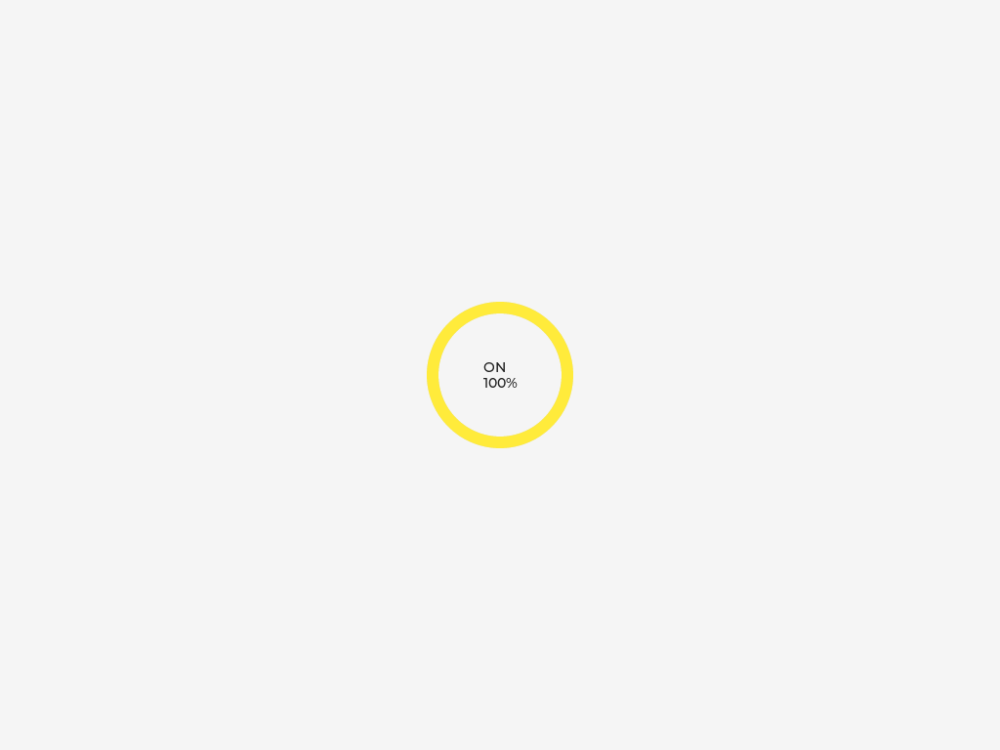

# Matter Light Bulb on Zephyr + QEMU

A commissionable Matter (project-chip/connectedhomeip) light bulb running on
Zephyr RTOS in QEMU (`qemu_x86`), commissioned over real Ethernet (no
BLE/Thread/Wi-Fi). See `plan/plan.md` and `plan/plan-detailed.md` for the
full design, milestones, and a retrospective of every real bug found getting
here (crypto backend, GN toolchain, SYS_INIT ordering, PCI IRQ routing,
etc.) — worth reading before touching the build if something breaks.

## Samples

Three independent, self-contained Zephyr applications, each buildable on its
own with no extra CLI flags:

- **[`0_plain/`](0_plain/)** — the base light bulb: on/off + level control,
  commissioning over Ethernet, persistent storage (survives QEMU restarts).
  Start here.
- **[`1_lvgl/`](1_lvgl/)** — `0_plain/` plus an LVGL widget (a yellow/grey arc +
  ON/OFF label) that reflects the bulb's on/off + level state in a QEMU
  window instead of only the console log.
- **[`2_llext/`](2_llext/)** — `0_plain/` plus a manufacturer-specific Matter
  cluster that can receive a Zephyr LLEXT (Linkable Loadable Extension)
  binary over Matter and load + run it at runtime. Includes sample
  extensions (`2_llext/extensions/`), a host-side script
  (`scripts/send-llext.py`) to send one, and a ztest suite for the cluster
  (`2_llext/tests/extension_value/`, run with `scripts/run-llext-ztest.sh`).
- **[`3_llext_lvgl/`](3_llext_lvgl/)** — `1_lvgl/` and `2_llext/` combined: the
  extension loaded over Matter *is* the bulb's LVGL UI. Includes two UI
  extensions (`3_llext_lvgl/extensions/ui_bar/`, `ui_led/`) and a ztest suite
  that screenshots them (`3_llext_lvgl/tests/extension_ui/`).

Each sample carries its own `prj.conf`, `boards/qemu_x86.{conf,overlay}`,
`include/CHIPProjectConfig.h`, and `src/`. `boards/qemu_x86.overlay` is
Zephyr's auto-detected board-devicetree-overlay convention — it's picked up
automatically by `west build`, no `-DEXTRA_DTC_OVERLAY_FILE` needed.

## Prerequisites

- Zephyr workspace at `~/src/zephyrproject` (west installed, `qemu_x86`
  board support present).
- A `connectedhomeip` checkout/worktree at
  `~/src/connectedhomeip-worktree-zephyr`, bootstrapped (its `.environment/`
  present). Each sample's `CMakeLists.txt` defaults `CHIP_ROOT` to this
  path; override with `-DCHIP_ROOT=...` if yours lives elsewhere.
- `zap-cli` on `PATH` for data-model codegen (see
  `.environment/extra-cipd/zap` under the CHIP checkout if you followed the
  same bootstrap as this project).
- QEMU with vmnet support (Homebrew's `qemu` formula has it).
- `chip-tool` built from the same CHIP checkout
  (`out/chip-tool/chip-tool`) for commissioning/control from the host.

## Build

```
source ~/src/connectedhomeip-worktree-zephyr/.environment/activate.sh
export PATH="~/src/connectedhomeip-worktree-zephyr/.environment/extra-cipd/zap:$PATH"

~/src/zephyrproject/zephyr/.venv/bin/west build -b qemu_x86 \
  ~/src/matter-zephyr-qemu/0_plain -d ~/src/matter-zephyr-qemu/build-plain
```

Swap `0_plain` for `1_lvgl`, `2_llext` or `3_llext_lvgl` (and `build-plain` for
`build-lvgl` / `build-llext` / `build-llext-lvgl` — build directories are
named without the number prefix) to build one of the other
samples — each needs its own build
directory since their Kconfig differs, but the command is otherwise
identical; no extra `-DEXTRA_CONF_FILE`/`-DEXTRA_DTC_OVERLAY_FILE` flags
required.

(`activate.sh` prints a harmless `ERR could not find arm-none-eabi-gcc`
check failure — this project doesn't need that toolchain; ignore it. Use
`west`'s absolute path, not a bare `west` on `PATH`: CHIP's own bootstrap
venv also ships a `west` package on an older Python, and if it shadows
Zephyr's own `west` the build fails with a `pathlib` crash. `west build`
must also be run from within the `~/src/zephyrproject` workspace — cd there
first, or pass the sample directory as an absolute path from wherever you
run it.)

## Run

```
scripts/run-qemu-macos.sh [build-plain|build-lvgl|build-llext|build-llext-lvgl]
```

Defaults to `build-plain`. Requires `sudo` (vmnet needs root) — run it
yourself in an interactive terminal so you can enter your password; it
can't be driven non-interactively. On first run it creates a 16 MiB disk
image at `<BUILD_DIR>/persistent.img` and Zephyr formats it FAT on first
boot. `run-qemu-macos.sh` auto-detects `CONFIG_DISPLAY=y` in the build
directory's `.config` (i.e. the `1_lvgl/` and `3_llext_lvgl/` samples) and opens a QEMU window
(`-device ramfb -vga none -display cocoa`) instead of running headless;
serial/monitor still work as normal over the terminal.

Optional args: `scripts/run-qemu-macos.sh [BUILD_DIR] [DISK_IMAGE]`.

### Commissioning

With the QEMU console running, from another terminal on the host:

```
dns-sd -B _matterc._udp                              # confirm the device is discoverable
out/chip-tool/chip-tool pairing onnetwork 1 20202021  # PASE + CASE
out/chip-tool/chip-tool onoff toggle 1 1
out/chip-tool/chip-tool levelcontrol move-to-level 128 0 0 0 1 1
```

(paths relative to the `connectedhomeip` checkout's `chip-tool` build output)

## Persistent storage

CHIP's Settings (fabric table, ACLs, session resumption, etc.) are stored in
a file on a FAT volume on a virtio-blk disk backed by
`<BUILD_DIR>/persistent.img`, instead of Zephyr's default `flash_simulator`
(which is RAM-backed and loses everything on every QEMU restart). This means
a device commissioned in one run is still commissioned after killing and
restarting QEMU, as long as the same disk image is reused — no
`isa-debug-exit`/normal QEMU shutdown, kill, or crash touches the image file
on disk. All samples build with this enabled.

**To reset persistence** (force re-commissioning, e.g. after changing the
data model or to start clean): delete the disk image and let the script
recreate it on the next run.

```
rm build-plain/persistent.img
scripts/run-qemu-macos.sh
```

## LVGL bulb UI (`1_lvgl/`)

An LVGL widget (a yellow/grey arc + ON/OFF label, `1_lvgl/src/gui/BulbUi.cpp`)
reflects the Matter on/off + level state in a QEMU window, instead of only
the console log.

`1_lvgl/boards/qemu_x86.overlay` shrinks the declared `dram0`/`zephyr,sram`
size to exclude the top 4 MiB the board reserves for the ramfb framebuffer
-- without it, the linker is free to place ordinary kernel/network data in
the same physical bytes the framebuffer driver claims exclusively, which
doesn't itself break networking but is a real memory-safety bug in the
board's own devicetree. The actual networking breakage this port hit was
separate: `-vga none` (needed whenever `CONFIG_DISPLAY=y`, since ramfb
replaces the default VGA adapter) removes the PCI device normally at slot
1, which shifts `e1000`'s auto-assigned slot and, with it, its real
interrupt line -- silently breaking all incoming UDP delivery (confirmed
via GDB: the e1000 ISR simply never fired). `run-qemu-macos.sh` pins both
`e1000` and `virtio-blk-pci` to explicit PCI slots to make this stable
regardless of what else is on the command line -- see its comments for the
full story.

## LLEXT loadable extensions (`2_llext/`)

A manufacturer-specific Matter cluster (`0xFFF1FC01`, EP1,
`2_llext/src/llext/ExtensionLoaderCluster.cpp`) receives a Zephyr LLEXT binary
over Matter in chunks, verifies it, and loads + runs it at runtime -- see
`plan/plan-detailed.md`'s Milestone 3 section for the full design and the
real bugs found getting it working (a QEMU CPU-model/CLFLUSH mismatch was
the big one).

### Building the sample extensions

`2_llext/extensions/hello/` is a trivial standalone extension (prints a
message, proving the load-then-call round trip). `value42/` and
`value1337/` additionally export `int32_t get_value(void)`, which backs the
cluster's `ExtensionValue` attribute (see below). All are built with
Zephyr's LLEXT EDK, not as part of the main app build:

```
cd build-llext
cmake --build . --target llext-edk   # produces zephyr/llext-edk.tar.xz
mkdir -p /tmp/edk && tar -xf zephyr/llext-edk.tar.xz -C /tmp/edk
cd ../2_llext/extensions/hello
export ZEPHYR_SDK_INSTALL_DIR=~/zephyr-sdk-1.0.1
export PATH="$ZEPHYR_SDK_INSTALL_DIR/gnu/x86_64-zephyr-elf/bin:$PATH"
cmake -B build -DLLEXT_EDK_INSTALL_DIR=/tmp/edk/llext-edk
cmake --build build   # produces build/hello.llext
```

Repeat the last three lines in `../value42` and `../value1337` for the other
two.

(`cmake --build build-llext --target llext-edk` needs the same CHIP
bootstrap environment sourced as a normal build -- see "Build" above --
plus, if invoked standalone rather than via `west build`, `PATH` needs
`~/src/zephyrproject/zephyr/.venv/bin` first so its own internal Python
lookup finds the venv, not a bare system `python3`.)

### Sending the extension

```
scripts/send-llext.py 2_llext/extensions/hello/build/hello.llext <node-id>
```

Drives chip-tool's generic `any command-by-id` invocation (no ZAP/codegen
entry needed for a manufacturer cluster) to send `LoadStart`/`LoadChunk`×N/
`LoadDone`. Watch the device's own console (or `<BUILD_DIR>/console.log`) for
`hello from llext` -- confirms the extension was loaded *and executed*, not
just linked. Read back progress with:

```
out/chip-tool/chip-tool any read-by-id 0xFFF1FC01 0 <node-id> 1   # Status: 0=Idle 1=Receiving 2=Loaded 3=Error
```

Only one extension is loaded at a time: a successful `LoadDone` unloads the
previous one before loading the new one.

### Extension-provided attribute value

Attribute 1 (`ExtensionValue`, nullable int32) is provided by the loaded
extension rather than by the app: if the extension exports
`int32_t get_value(void)` (`LL_EXTENSION_SYMBOL(get_value)`), every read of
the attribute calls it and returns the result. It reads as null when nothing
is loaded or the extension has no `get_value` (e.g. `hello`).

```
scripts/send-llext.py 2_llext/extensions/value42/build/value42.llext <node-id>
out/chip-tool/chip-tool any read-by-id 0xFFF1FC01 1 <node-id> 1   # Data = 42 (signed)
```

### Tests

```
scripts/run-llext-ztest.sh
```

builds `2_llext/tests/extension_value/` into `build-llext-test/` and runs it
under QEMU -- **no sudo, no commissioning, no chip-tool needed**. It is a
Zephyr ztest suite that links the real `ExtensionLoaderCluster` with the
`2_llext/` sample's own Kconfig/devicetree, embeds `hello`, `value42` and
`value1337` (built in-tree from the same sources via `add_llext_target`),
and drives the cluster's actual `LoadStart`/`LoadChunk`/`LoadDone` and
`ReadAttribute` handlers with TLV-encoded requests -- everything except the
Matter transport. It checks that:

- `ExtensionValue` is null with nothing loaded;
- loading `value42` → `value1337` → `value42` reads back 42 → 1337 → 42;
- an extension without `get_value` (`hello`) reads back null;
- a transfer with a bad CRC fails, leaves the previous extension (and its
  value) in place, and a correct retry then works.

The script exits 0 only on ztest's `PROJECT EXECUTION SUCCESSFUL`; the full
console output is in `build-llext-test/console.log`.

`scripts/test-llext-values.py <node-id>` is the over-the-air counterpart: run
against a running, commissioned `build-llext` device (so it needs
`run-qemu-macos.sh` and its sudo), it sends `value42`, `value1337` and
`value42` again through chip-tool and checks that `ExtensionValue` reads back
42 / 1337 / 42.

## Extension-provided LVGL UI (`3_llext_lvgl/`)

Combines the two samples above: the device shows the `1_lvgl/` sample's bulb
widget until an extension that provides a UI is loaded through the
`ExtensionLoaderCluster`, which then replaces it -- no rebuild or restart of
the device. Loading another extension swaps the UI again; the new UI picks
up the bulb's current on/off + level state.

| built-in | `ui_bar` | `ui_led` |
| --- | --- | --- |
|  |  |  |

(Screenshots taken by the test suite below.)

### Writing a UI extension

The contract is `3_llext_lvgl/include/bulb_ui_extension.h`: export two
functions with `LL_EXTENSION_SYMBOL`,

```c
void ui_create(lv_obj_t *parent);          /* build the UI inside parent */
void ui_update(bool on, uint8_t percent);  /* show the bulb's state */
```

Both are called on the app's GUI thread only. `parent` is a screen-sized
container owned by that UI; the app deletes it, and everything in it, before
the extension is unloaded, so there is no destroy hook.

An extension can only call the LVGL functions the app exports to it, listed
in `3_llext_lvgl/src/gui/LvglExports.c` (objects, local styles, colors, and
the label/arc/bar/led widgets). Calling anything else makes the load fail
with `Undefined symbol ...` on the device console and `TransferStatus` =
Error; add an `EXPORT_SYMBOL` line there and rebuild the app. (`static
inline` LVGL helpers such as `lv_pct()` need no entry.)

### Building and sending the UI extensions

Same procedure as for `2_llext/` ("Building the sample extensions" above),
against this sample's own EDK:

```
cd build-llext-lvgl
cmake --build . --target llext-edk
mkdir -p /tmp/edk-lvgl && tar -xf zephyr/llext-edk.tar.xz -C /tmp/edk-lvgl
export ZEPHYR_SDK_INSTALL_DIR=~/zephyr-sdk-1.0.1
export PATH="$ZEPHYR_SDK_INSTALL_DIR/gnu/x86_64-zephyr-elf/bin:$PATH"
for ext in ui_bar ui_led; do
  cmake -S ../3_llext_lvgl/extensions/$ext -B ../3_llext_lvgl/extensions/$ext/build \
    -DLLEXT_EDK_INSTALL_DIR=/tmp/edk-lvgl/llext-edk
  cmake --build ../3_llext_lvgl/extensions/$ext/build   # produces build/$ext.llext
done
```

With `scripts/run-qemu-macos.sh build-llext-lvgl` running and the device
commissioned:

```
scripts/send-llext.py 3_llext_lvgl/extensions/ui_bar/build/ui_bar.llext <node-id>
out/chip-tool/chip-tool onoff on <node-id> 1
out/chip-tool/chip-tool levelcontrol move-to-level 128 0 0 0 <node-id> 1
scripts/send-llext.py 3_llext_lvgl/extensions/ui_led/build/ui_led.llext <node-id>
```

The QEMU window switches from the arc to the dimmer bar, follows the on/off
and level commands, then switches to the lamp. An extension without
`ui_create`/`ui_update` (e.g. `2_llext/`'s `hello`) still loads; the UI then
falls back to the built-in one.

### Tests

```
scripts/run-llext-ztest.sh 3_llext_lvgl/tests/extension_ui
```

Like the `2_llext/` suite, this needs no sudo, commissioning or chip-tool, and
opens no window. It runs the real cluster, GUI thread and LVGL rendering in
QEMU, loads `ui_bar` → `ui_led` → `ui_bar` through the cluster's command
handlers while changing the bulb state, and finally drops the cluster to
check the built-in UI comes back. After each step the script saves a QEMU
screendump to `build-llext-lvgl-test/screenshots/<step>.png`. Besides
ztest's own verdict, the run fails if a screenshot is missing or if any two
are identical -- every step is supposed to change the picture. Look at the
PNGs to judge the UIs themselves.

## Debugging tools

`run-qemu-macos.sh` also supports:
- `GDB=1 scripts/run-qemu-macos.sh ...` -- exposes a GDB stub on `tcp::1234`
  (`-s`, boot proceeds normally). Attach with e.g.
  `~/zephyr-sdk-*/gnu/x86_64-zephyr-elf/bin/x86_64-zephyr-elf-gdb <build>/zephyr/zephyr.elf -ex "target remote :1234"`.
- A second, scriptable QEMU monitor at `<BUILD_DIR>/mon.sock` (HMP, in
  addition to the normal interactive one on the terminal via `Ctrl-A C`) --
  useful for e.g. `info pci` to check real PCI slot/IRQ assignments without
  needing to switch away from the serial console.
- Console output (serial + the interactive monitor) is duplicated to
  `<BUILD_DIR>/console.log` (truncated each run) for inspection without
  copy-pasting from the terminal.

## Logging

Each sample's `include/CHIPProjectConfig.h` mutes Progress/Detail-level
logging from CHIP's Exchange Manager (`EM`), Secure Channel (`SC`), and
interaction-model/data-management (`DMG`) log modules — these are extremely
chatty (every message send/receive, every attribute read) and were drowning
out everything else, including ZCL (`ZCL`) logging, in the 16 KB log ring
buffer. Error-level logging from all three is left intact; ZCL and all
other modules are unaffected.
